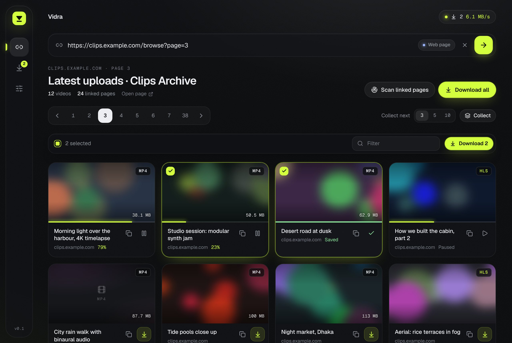
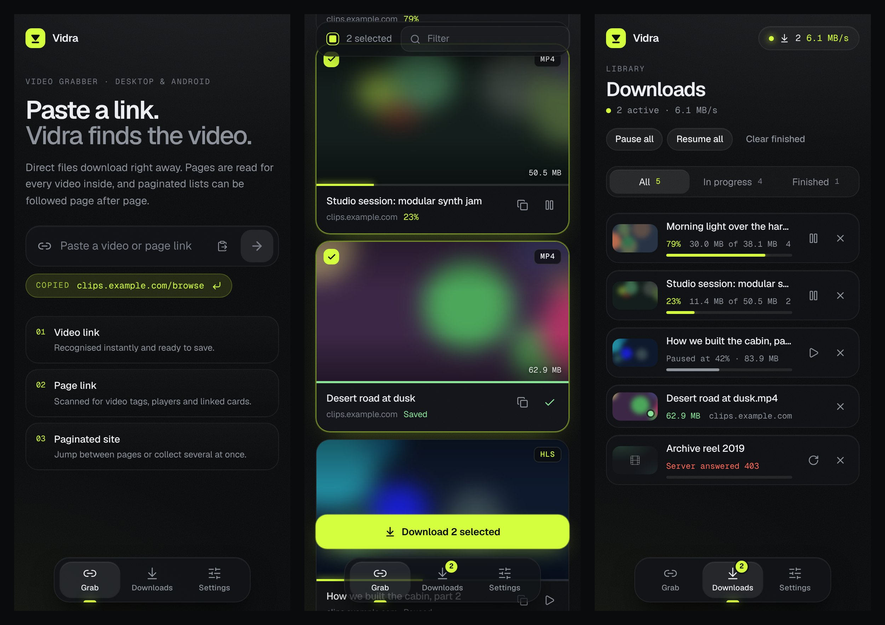

<p align="center">
  
</p>

<h1 align="center">Vidra</h1>

<p align="center">
  Paste a link. Vidra finds the video.<br/>
  A fast, good-looking video downloader for <b>Windows</b> and <b>Android</b>, built with Tauri 2, Rust and Svelte.
</p>



## What it does

Paste (or on Android, **Share**) any link and Vidra decides what it is:

| You paste | Vidra does |
| --- | --- |
| **A video link** (`.mp4`, `.webm`, `.mkv`, `.mov`, …) | Recognises it instantly, shows size and type, ready to download. |
| **A stream link** (`.m3u8`) | Picks the best quality, downloads every segment (including AES-128 encrypted streams) and joins them. |
| **A web page** | Reads the HTML for every video: `<video>`/`<source>` tags, Open Graph and JSON-LD video data, direct file links, and player configs hidden in scripts. |
| **A listing page** with no videos on it | Opens each card/thumbnail it links to and collects the videos inside ("Look inside linked pages"). |
| **A paginated site** | Detects the pagination (`rel="next"`, numbered links, "Next ›" buttons, or `?page=N` / `/page/N` URL patterns) and keeps scraping page after page until the last one, with a live count of pages and videos and a **Stop** button. You can also jump to any single page. |

When a page offers the same video in several qualities (360p/720p/1080p files, or an MP4 and an HLS stream of one clip), Vidra lists it once and keeps the best one.

Downloads run 2 at a time with live speed and time left, wait and retry automatically when a site answers "429 Too Many Requests", can be paused and resumed (even after closing the app), retry automatically when a connection drops, and keep the cookies and referer from the page you scanned, so sites that check them still work.

<p align="center"></p>

## Install

Grab the latest build from [Releases](https://github.com/MisbahKhan0009/Video-Downloader/releases):

- **Windows:** `Vidra_x.y.z_x64-setup.exe` (or the `.msi`)
- **Android:** `Vidra_x.y.z_android.apk` (allow installs from unknown sources)

Files are saved to `Downloads/Vidra` on both platforms. The folder can be changed in Settings on Windows.

## Build from source

Requirements: Node 22+, Rust (stable), and the [Tauri prerequisites](https://tauri.app/start/prerequisites/) for your OS.

```bash
npm install
npm run tauri dev            # desktop, hot reload
npm run tauri build          # desktop installer
```

Android (needs Android SDK + NDK, `ANDROID_HOME` and `NDK_HOME` set):

```bash
rustup target add aarch64-linux-android armv7-linux-androideabi x86_64-linux-android
npm run tauri android dev    # on a connected phone or emulator
npm run tauri android build -- --apk
```

### Releases via GitHub Actions

Every push to `main` runs the tests, builds the Windows installers and the Android APK, and publishes them to the GitHub Release for the current version (`v` + `version` in `src-tauri/tauri.conf.json`). Pushing again refreshes that release's files. To start a new release, bump the version (in `tauri.conf.json`, `package.json` and `src-tauri/Cargo.toml`) and push.

To keep one stable Android signing key (so updates install over the old version), add these repository secrets:

| Secret | Value |
| --- | --- |
| `ANDROID_KEYSTORE_BASE64` | `base64 -w0 release.jks` |
| `ANDROID_KEYSTORE_PASSWORD` | keystore password |
| `ANDROID_KEY_ALIAS` | key alias |
| `ANDROID_KEY_PASSWORD` | key password (optional, defaults to keystore password) |

Create a keystore with `keytool -genkeypair -v -keystore release.jks -alias vidra -keyalg RSA -keysize 2048 -validity 10000`. Without the secrets, CI signs with a throwaway key.

## How it works

```
src/                       Svelte 5 UI (SvelteKit, static)
  lib/store.svelte.ts      app state: grab, pagination, deep scan, downloads
  lib/components/          link bar, cards, pager, downloads, settings
src-tauri/src/
  net.rs                   HTTP client (shared cookies), link classification, file naming
  scan.rs                  HTML scanner: videos, pagination, linked cards
  analyze.rs               "video or page?" detection, page fetch, deep scan
  download.rs              resumable downloads, HLS (master playlists, AES-128), progress events
  e2e.rs                   end-to-end test against a local mock site
```

Run the tests with `cargo test --manifest-path src-tauri/Cargo.toml`.

## Limits

- Pages that only build their player after JavaScript runs, and sites using DRM (Widevine, FairPlay, SAMPLE-AES) can't be read from the HTML. Vidra tells you when a page has nothing it can save.
- DASH (`.mpd`) streams aren't supported yet. HLS streams are saved as `.ts` (or `.mp4` for fMP4 streams).
- Only download videos you have the right to save.

## License

MIT
